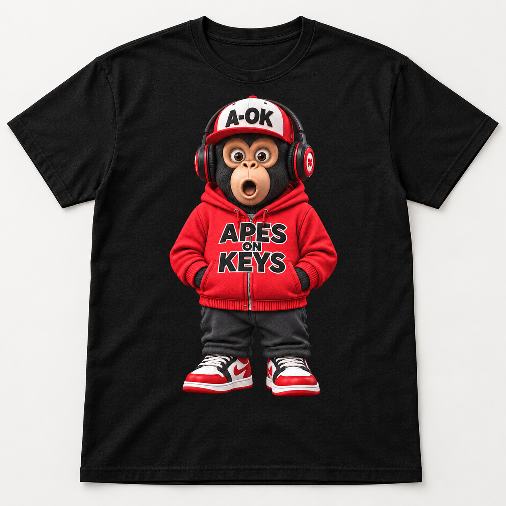

# Apes on Keys Graphic T-Shirt — Black

Catalog intake package for the single, front-facing red-hoodie ape. This is distinct from the existing All Angles Tee and Operator Turnaround Hoodie, which use multiple views of the character.

## Status

Assets and copy are ready for catalog integration. Pricing, garment specifications, variants, and production approval are pending. The intake JSON is not a live `Product` record and is not read by the storefront, feeds, checkout, or Stripe sync. Do not append it directly to `product-catalog.json`.

## Files

- [Transparent artwork](transparent-artwork.png): original generated RGBA PNG, 1024 × 1536. Print source with actual alpha transparency.
- [Black T-shirt mockup](../../public/images/products/apes-on-keys-black-graphic-tee-front.png): original generated PNG, 1254 × 1254. Suggested lead catalog image; conceptual garment rendering, not a measured production proof.
- [Original reference sheet](source-reference.png): supplied multi-view reference, retained for provenance; not the shirt print file.
- [Product copy](product-copy.md): title, short and full descriptions, highlights, CTA, SEO title/description, slug, and alt text. The final internal merchandising note is excluded from the JSON description.
- [Catalog source record](../../catalog-sources/apes-on-keys-black-graphic-tee.json): reusable copy and image metadata, asset checksums, source links, and explicit pending production fields.
- [Generation prompts](generation-prompts.md): prompts and generation method for the selected outputs.

## Print handoff

The transparent artwork was adapted from the large front-facing character; the three smaller reference views are excluded. Preserve its alpha channel. Hidden RGB colors under transparent pixels must not be flattened onto a garment background.

| Resolution | Full canvas size |
| --- | --- |
| 300 PPI | 3.41 × 5.12 inches |
| 200 PPI | 5.12 × 7.68 inches |
| 150 PPI | 6.83 × 10.24 inches |

The visible silhouette is slightly smaller than the canvas. A 6 × 9 inch canvas placement yields about 171 PPI. This is **not a full chest-size 300-PPI master**; a 12 × 18 inch master requires actual 3600 × 5400 pixel artwork. Changing DPI metadata does not add detail. The mockup placement is illustrative.

Confirm the final size with the printer and review a physical sample. The printer supplies any garment-specific white underbase, color conversion, and production settings. Full-color raster artwork is provided; vector paths and screen-print separations are not included. Use the transparent artwork, not the T-shirt mockup, for printing.

## Add to the live catalog

1. Confirm garment/supplier, fabric, fit, supported sizes, care, price, currency, and product/variant SKUs. The store defaults to XS–2XL; set `supportedSizes` if the selected blank requires a narrower range.
2. Approve the print resolution and production sample, or replace the print source with a suitable higher-resolution master.
3. Create the complete product and variant records in `product-catalog.json`, following `app/lib/catalog.ts`. Use the intake description, SEO fields, image metadata and proposed handle; assign unique product, option, image, and variant IDs using catalog conventions. Set sale availability only after production and pricing are confirmed.
4. Follow [Stripe catalog synchronization](../../STRIPE_CATALOG_SYNC.md), then check listing, product detail, size/color selection, cart, and checkout.

## Source files

- [Drive asset folder](https://drive.google.com/drive/folders/1XNTzHtHXMU3FB2d2s1Nza_tWSvwCPePu)
- [Editable product copy](https://docs.google.com/document/d/1qRiazv0ihYyggNcC3ZlZ5Fl_aOM0913A3KlJw1ZFZ5M/edit)

The repository includes the image bytes and copy so catalog work does not depend on Drive access. Image files are copied without re-encoding or upscaling.
